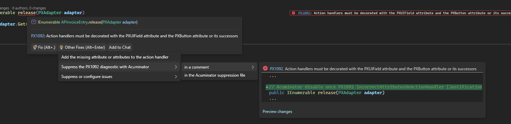
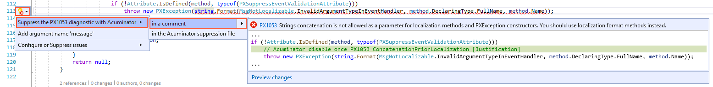
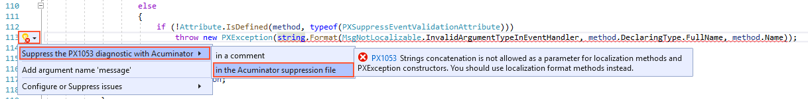

# Acuminator Diagnostic Suppression

## Overview

Sometimes you know better than an automatic code analyzer. You may have a good reason to ignore an alert and to tell the analyzer about your decision.

Acuminator allows developers to suppress its diagnostics in several way. First of all, Acuminator supports Visual Studio suppression mechanisms, such as the compiler pragma directives and the
[`System.Diagnostics.CodeAnalysis.SuppressMessage`](https://docs.microsoft.com/en-us/dotnet/api/system.diagnostics.codeanalysis.suppressmessageattribute?view=netframework-4.8) attribute. 
There are also ways to configure code analysis with .editorconfig files, see see [Support for EditorConfig Files in Acuminator](./EditorConfigSupport.md).

However, due to various reasons the existing VS suppression mechanisms are not very convenient to work with. Therefore, Acuminator provides two additional mechanisms to suppress its diagnostics:

* *Local suppression* with Acuminator suppression comments
* *Global suppression* in an Acuminator suppression file

Each of the mechanisms is used for different scenarios. Local suppression provides a notice to the reader that there is an Acuminator alert suppressed due to the specified reasons. 
Global suppression does not provide any information regarding alerts suppressed in the code or the reason for the suppression of the alert to the reader. It is used to suppress errors in our legacy code 
in an automated way to avoid huge rewrite of the legacy code. Acuminator provides an easy way to suppress a diagnostic globally in the global suppression file.

**The recommendation is to use local suppression with comments in the code wherever possible.**

The Acuminator suppression mechanism differs from the standard C# and .Net diagnostic suppression mechanisms. With Acuminator suppression mechanisms, you can suppress a particular diagnostic granularly in a specific place inside the code. 
The standard suppression mechanisms either suppress all diagnostics with this ID in the type or its member or force you to use pragma directives which degrade code readability and are disliked by many developers. 

The article provides the detailed description of both Acuminator suppression mechanisms.

## Local Suppression with Acuminator Suppression Comment

To use Acuminator local suppression with a suppression comment you need to add a C# comment above the line with alert in the following format.

```cs
// Acuminator disable once <diagnostic ID> <short diagnostic name> <optional justification>
```

Here is how it looks in practice for the [PX1003](./diagnostics/PX1003.md) diagnostic:
```cs
// Acuminator disable once PX1003 NonSpecificPXGraphCreateInstance [Justification]
```

Notice the `NonSpecificPXGraphCreateInstance` part. It is a *short diagnostic name* which should quickly tell the reader of the code what error is suppressed there. 

There is also the optional `[Justification]` placeholder. Its presence or absence doesn't affect Acuminator behavior. However, it is there for a reason. 
You should replace the `Justification` placeholder with a reason for the suppression of the alert, as the following example shows.
```cs
// Acuminator disable once PX1003 NonSpecificPXGraphCreateInstance Created instance of base graph to just read some data from the database
var graph = new PXGraph();
```
Note that it is not necessary to surround the justification with square braces.

If Acuminator displays multiple diagnostics for one line, you can add multiple suppression comments for this line (one comment under another). To stop the suppression of a diagnostic in the code fragment, you remove the comment that corresponds to the diagnostic from the code.

There are two general ways to write the suppression comment - typing it manually yourself or generate in automatically in Visual Studio.

### Writing Suppression Comment Manually

You can write Acuminator suppression comments manually. If you don't use Visual Studio, this is your only option. You just need to type the comment on the line above the reported Acuminator error. 
The only difficult thing in writing suppression comments by yourself is understanding what is the diagnostic short name required by the comment. 
It can be found in Acuminator resource files [here](https://github.com/Acumatica/Acuminator/blob/dev/src/Acuminator/Acuminator.Analyzers/DiagnosticsShortName.resx).

However, you don't need to do this manually. Each diagnostic has a corresponding documentation page with the URL in the following format:
```text
http://github.com/Acumatica/Acuminator/blob/dev/docs/diagnostics/<diagnostic ID>.md
```
For example, for PX1007 diagnostic the documentation page is [http://github.com/Acumatica/Acuminator/blob/dev/docs/diagnostics/**PX1007**.md](http://github.com/Acumatica/Acuminator/blob/dev/docs/diagnostics/PX1007.md). 
At the end of each diagnostic documentation page there is a section "**Acuminator Suppression Comment**" with the suppression comment for the corresponding diagnostic.

### Generating Suppression Comment In Visual Studio

If you use Acuminator with Visual Studio, you don't need to go anywhere. Acuminator provides a code fix that will generate the comment automatically. The access to the code fix in the UI depends on the version of Visual Studio you are using.
In all versions of Visual Studio the result will be the same generated Acuminator suppression comment placed on the line above the error. Here is an example of a suppression comment generated by the code fix in Visual Studio. 
```cs
...
else
{
	if (!Attribute.IsDefined(method, typeof(PXSuppressEventValidationAttribute)))
		// Acuminator disable once PX1053 ConcatenationPriorLocalization [Justification]
		throw new PXException(string.Format(MsgNotLocalizable.InvalidArgumentTypeInEventHandler, method.DeclaringType.FullName, method.Name));
	else
		return null;
}
...
```

The suppression comment in the code above includes the following parts:
 - The ID of the [PX1053](./diagnostics/PX1053.md) diagnostic.
 - The short diagnostic name `ConcatenationPriorLocalization`, which can give readers an idea of what the suppressed diagnostic is about.
 - The `[Justification]` placeholder. You should replace it with the explanation of why the Acuminator alert is suppressed in this place.

#### Visual Studio 2026

For Visual Studio 2026 the code fix is shown in the screenshot below. Notice that you have to initially go for "Other Fixes" to use classic non-AI code fixes in Visual Studio. The rest is the same as in the older versions of VS.


#### Visual Studio 2022 and Older Versions

For Visual Studio 2022 and older versions the code fix is displayed on the following screenshot:


## Global Suppression in Acuminator Suppression File

Acuminator global suppression is a mechanism that allows you to keep information about suppressed Acuminator diagnostics in your C# project in a separate suppression file. 
There can be only one suppression file for each C# project which should be placed into the project's root folder. This file must have the following name.
```text
<Project name>.acuminator
```

The suppression file must be specified as an additional file in the .csproj project file as shown below.
```xml
<ItemGroup>
  <AdditionalFiles Include="<Project name>.acuminator" />
</ItemGroup>
```

Note that it will be very hard to do add entries to the suppression file manually. If you want to use the global suppression mechanism, it is recommended to use a code fix in Visual Studio. To suppress a diagnostic in the Acuminator suppression file, 
you select **Suppress the PXnnnn diagnostic with Acuminator > in the Acuminator suppression file** (where PXnnnn is the code of the diagnostic) as a code fix for the diagnostic. 

The following screenshot shows how the code fix looks in Visual Studio 2022.


To stop a suppression of some Acuminator error in a particular place in the code, you need to remove the corresponding suppression record from the Acuminator suppression file.

### Suppression Record Format

Global suppression files may contains thousands of records. Each record contains information about the corresponding suppressed error which includes the ID of suppressed diagnostic, a type or type member containing the error, 
and a saved information on a syntax node with an error. Here is how a record in the suppression file may look.
```xml
<?xml version="1.0" encoding="utf-8"?>
<suppressions>
  <suppressMessage id="PX1001">
    <target>PX.Objects.AR.ARStatementMaint.recreateLast(PX.Data.PXAdapter)</target>
    <syntaxNode>new StatementCycleProcessBO()</syntaxNode>
  </suppressMessage>
  ...
</suppressions>
```
In practice, global suppression files are usually generated automatically. You can generate the suppression file for the whole project automatically with the [Acuminator Console Runner](./AcuminatorCLI.md).